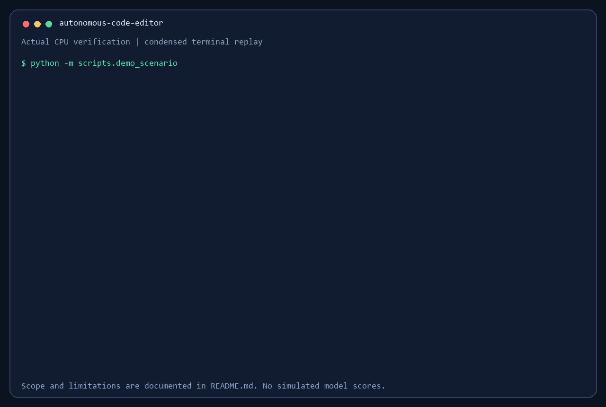

# Tree-sitter Editor + Async Search Workflow

Two explicit components: a real deterministic Python function editor and a separate async search workflow. A bounded model-proposal/verification loop is available through a configured model gateway; model capability has not been benchmarked.

## AST editing
ast_editor.py selects one top-level Python function with Tree-sitter, replaces its byte span and validates the result with both Tree-sitter and Python's parser. It preserves unrelated code and rejects ambiguous functions, invalid replacements, path traversal and symlinks.

evaluate_in_worktree applies a candidate in a disposable detached Git worktree, optionally runs an explicit verification command, returns the diff/output and removes the worktree. The original checkout is unchanged.

~~~sh
pip install -r requirements.txt
python ast_editor.py --repo /path/to/repo --file example.py --function add --replacement candidate.txt
python -m scripts.demo_scenario
python -m pytest -q
~~~
The CLI previews a diff. Worktree verification requires a clean committed source. **Git isolation is not an OS security sandbox.** Verification runs with your user privileges; do not execute untrusted code on a host with secrets.

## Async workflow
FastAPI dispatches a fixed two-node LangGraph search workflow through Redis/ARQ.
- Search calls run off the event loop with a timeout.
- Provider failures return failed states instead of invented results.
- Events use task-scoped channels and random per-task capability tokens.
- Last-event snapshots support reconnect/status retrieval, not complete event replay.
- Cancellation is cooperative; it does not kill an active network thread.

Run docker compose up --build for the real Redis/ARQ configuration. For a single-process local demo, explicitly set AGENT_DEMO_MODE=1 and REDIS_HOST=localhost, then run uvicorn main:app --host 127.0.0.1 --port 8000.
POST /agent/run returns task_id and task_token. Status/cancel require X-Task-Token. SSE takes task_id and token query parameters; keep capability URLs out of logs.
No user-account authentication, admission control or full durable event history is provided. Docker/Redis deployment was not verified on this host.

## Evidence
The CPU suite passed **12 tests**, including Unicode edits, invalid paths, successful/failed real Git-worktree checks, task authorization and provider failure.

The old **45% token reduction, 92% fix rate, 446 RPS and 0.88 ms** showcase claims are withdrawn.
- token_comparison uses an actual tokenizer, but measures only replacement-output payload versus full-file output for one input. It excludes prompts, retries and reasoning.
- run_benchmark.py measures **in-process dispatch to a mock queue**. It does not open SSE streams or execute workers.
- No representative bug-repair dataset has been evaluated; do not infer a fix rate from unit-test success.

## Demonstration

[Static PNG](assets/demo.png) | [Raw commands and output](assets/demo-transcript.json)

These assets are condensed terminal replays rendered from actual subprocess output. They are not screenshots of a production deployment.
Regenerate: install requirements-demo.txt, then run python scripts/render_demo.py.

[Engineering changes and ownership exercises](OWNERSHIP.md)

## Bounded repair loop
repair_agent.py requests one function replacement, validates it, runs trusted verification in a detached worktree and sends real failure feedback to the next attempt. Attempts are bounded (default 3, maximum 5); the original checkout is never modified automatically. Passing tests produces a reviewable candidate diff, not a correctness guarantee.

Configure a model gateway and run:
~~~sh
python repair_agent.py --repo /path/to/clean/repo --file example.py --function add --task "Fix addition" --base-url http://localhost:11434/v1 --model your-local-model --output result.json --allow-local-execution --verify python -m pytest -q
~~~
REPAIR_API_KEY optionally supplies a gateway key. No paid API calls were made and no model gateway was available here. Tests inject deterministic proposals and exercise actual failed/successful subprocess verification and feedback. The default context budget is 50,000 characters; max feedback is 4,000 characters, max completion request is 2,048 tokens. This is not a total token/cost budget.

## Model-driven GPU probes

[Repair probe runner](benchmarks/README.md) tests actual local model proposals on three disclosed tasks with bounded worktree verification. Fixtures were checked locally; CUDA model runs are pending. These probes cannot establish a general repair-success rate.

## Remaining runtime checks

[GPU model-repair notebook](benchmarks/colab_model_repairs.ipynb) runs actual local-model probes in a Drive-free disposable session. Live Redis/ARQ tests are in tests/test_redis_integration.py and have a Linux CI service job. Windows ARQ lifecycle uses unsupported POSIX signals, so this integration test is skipped locally. Both external runs remain pending; a TCP fake was insufficient to verify the real Redis service.

[Continuation handoff](HANDOFF.md) records verified work, pending checks, the active Colab run and recovery steps.
